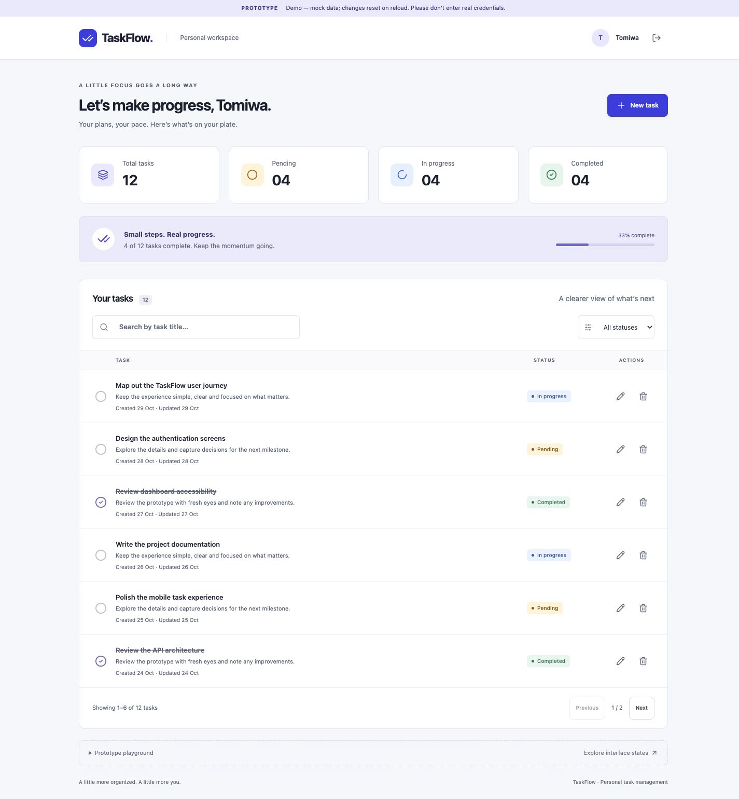

# TaskFlow — AppRo8 Task 2

TaskFlow is a deployed full-stack task manager for the AppRo8 Full Stack Developer Internship. The React frontend communicates with a Node.js/Express API backed by MongoDB Atlas.

- **Frontend:** https://task-manager-fullstack-vert-five.vercel.app
- **Backend health:** https://task-manager-fullstack-4wf9.onrender.com/api/health
- **Backend base URL:** https://task-manager-fullstack-4wf9.onrender.com
- **Public GitHub repository:** https://github.com/Oseni-Tomiwa/task-manager-fullstack

**Release status:** the owner verified all eight core production workflows. Local release hardening is documented in [Phase 5.3.1](docs/phase-5.3.1-release-hardening.md); proxy client identity/rate-limit verification and controlled authenticated/browser acceptance remain open. Deployment does not imply an unconditional security sign-off. Atlas credential rotation, Render credential replacement and disabled startup diagnostics are **owner-confirmed**, not independently verified.

## Functionality

Register an account, sign in and return to your session after refresh. Create, view, edit, complete/reopen and delete your own tasks. Search task titles, filter by status and paginate the list. Global summary counters describe all your tasks independently of the active list filter. Forms and lists include loading, empty, validation, retry, error and success states; failed writes retain inputs.

The client includes a protected read-only Profile with the signed-in user's display name, email address, and member-since date. Profile was verified locally with client tests and browser fixtures. Hosted acceptance of Profile remains pending.

The dashboard uses responsive layouts, labeled controls, visible keyboard focus and focus-managed dialogs. Fresh production viewport/keyboard verification remains a documented acceptance requirement. Production statuses are `todo`, `in_progress` and `completed`.

Open the canonical frontend to register your own account. There are no shared production demo credentials. Public registration is intended for reviewers; never put reusable production credentials in this README. The separate prototype's mock credentials do not authenticate against the deployed API.

## Architecture and security contracts

Browser HTTPS → Vercel React/Vite frontend → same-origin `/api` rewrite → Render Express API → MongoDB Atlas.

The active `client/vercel.json` forwards `/api/:path*` to the fixed Render `/api/:path*` endpoint before an SPA fallback that excludes API paths. API caching is explicitly disabled with browser/shared/platform no-store directives and Vercel's rewrite-cache opt-out. Static frontend assets may be cached normally.

The API stores bcrypt password hashes and issues a 30-minute JWT only in an HttpOnly, Secure, SameSite=Lax, host-only production cookie. Tokens are not returned in public user JSON or stored by the frontend in localStorage. Mutations require the exact canonical Origin, `X-TaskFlow-Request: 1` and JSON content type. Logout and task DELETE send JSON `{}`. All task operations and summary aggregation are scoped to the authenticated owner. No permissive API CORS policy is enabled.

Express proxy trust remains false. Login and registration share a 10-attempt/15-minute in-memory limiter keyed by the apparent peer identity; multiple legitimate clients **can** share a key behind a proxy. Do not treat forwarded headers or Origin as authenticated proof of Vercel traffic. The proposed verification and minimal conditional correction are in the hardening report; no trust-policy change has been made.

## Repository structure

```text
task-manager-fullstack/
├── client/       # React, TypeScript, Vite, Tailwind CSS, React Router
├── server/       # Node.js, Express, TypeScript, Mongoose, JWT, bcrypt, Zod
├── prototype/    # Historical approved mock-only UI, separate from production
├── docs/         # Decisions, milestone evidence, screenshots and release gates
├── .nvmrc
└── LICENSE
```

Client, server and prototype have independent pnpm manifests/lockfiles. Historical reports preserve the decisions and evidence from their dates; current release status is in Phase 5.3/5.3.1.

## Local setup

Use Node.js **24.x** (24.10 or later within 24.x; `.nvmrc` selects 24.22.1) and **pnpm 10.15.1** from each package's `packageManager` pin. Use an existing trusted Corepack installation where available. Do not bypass package-manager signature verification.

Install each application independently:

```sh
cd server
corepack pnpm install --frozen-lockfile
cp .env.example .env
# Configure the ignored .env privately for an authorized development database.
```

```sh
cd client
corepack pnpm install --frozen-lockfile
```

Start an authorized development MongoDB instance; never point local tests or development at production Atlas. Configure the server variables below, then run the applications in separate terminals:

```sh
cd server
corepack pnpm dev
```

```sh
cd client
corepack pnpm dev
```

Open **http://127.0.0.1:5173** and register a development account. Use that exact host: `localhost` is a different Origin. Vite's development-only proxy forwards `/api` to loopback port 3000 without replacing Origin. Static `pnpm preview` does not run Vercel's API proxy.

## Environment requirements

Real `.env` files and `.vercel/` metadata are ignored. Never commit credentials, connection strings containing credentials, JWTs or private environment values. Example files contain configuration examples/placeholders only.

| Variable              | Where          | Requirement                                                                                                                              |
| --------------------- | -------------- | ---------------------------------------------------------------------------------------------------------------------------------------- |
| `MONGODB_URI`         | Server only    | Private URI for the intended authorized database; production database is `taskflow`. Never expose it to Vite.                            |
| `JWT_SECRET`          | Server only    | Privately generated 64-character hexadecimal signing secret. Never expose it to the client or logs.                                      |
| `CLIENT_ORIGIN`       | Server         | Local: `http://127.0.0.1:5173`; production: `https://task-manager-fullstack-vert-five.vercel.app`, without trailing slash/path/wildcard. |
| `NODE_ENV`            | Server         | `development` locally; `production` on Render for Secure production cookies.                                                             |
| `HOST`                | Server         | Local loopback default; Render requires `0.0.0.0`.                                                                                       |
| `PORT`                | Server         | Local default 3000; use Render's assigned port in production.                                                                            |
| `STARTUP_DIAGNOSTICS` | Server         | Temporary opt-in diagnostics only for exact `1`; leave disabled in normal production. Owner confirms disabled.                           |
| `VITE_API_BASE_URL`   | Client, public | Optional; defaults to `/api`. Keep same-origin `/api`, not the direct Render URL.                                                        |

See [server setup](server/README.md), [client setup](client/README.md) and [authentication decisions](docs/authentication-decision.md) for detailed contracts. Generate signing credentials privately; do not paste them into issue reports, screenshots or shell transcripts.

## Tests and builds

From **each** application directory:

```sh
corepack pnpm typecheck
corepack pnpm lint
corepack pnpm format:check
corepack pnpm test
corepack pnpm build
```

The default backend suite uses mocks/in-memory database substitutes. Dedicated real-database tests run separately:

```sh
cd server
corepack pnpm test:integration
```

That suite reads only the dedicated ignored `.env.integration` file and refuses targets other than its credential-free, fixed loopback database on port 27018 named `taskflow_integration_test`. Run it only against the explicitly authorized disposable local test instance. It creates and cleans run-specific local records; it does not use the normal `.env` or production URI. Do not remove its safety guard.

Latest executed results, repeat-test evidence and verification limits are recorded in [Phase 5.3.1](docs/phase-5.3.1-release-hardening.md). A local build/test pass is not hosted cookie, proxy, caching or browser acceptance evidence.

## Deployment configuration and reliability

The deployed frontend uses Vercel root directory `client`, Vite, Node 24.x and output `dist`. `client/vercel.json` installs with `corepack pnpm install --frozen-lockfile` and builds with `corepack pnpm build`; Vercel's Corepack opt-in is `ENABLE_EXPERIMENTAL_COREPACK=1`.

The backend uses Render root directory `server`, Node 24, build command `corepack pnpm install --frozen-lockfile --prod=false && corepack pnpm build`, and start command `node dist/index.js`. Dev dependencies are needed at build time for TypeScript. It connects and awaits User/index initialization before listening. Health path `/api/health` returns `{"status":"ok"}` and remains process liveness, not continuous database readiness. SIGTERM/SIGINT cleanup drains HTTP and closes the database with a deadline.

These are the reviewed deployment settings; current dashboard values and deployed commit identity still need owner confirmation. Atlas access must stay restricted to the intended database role and authorized Render egress ranges. No secrets belong in Vercel build variables.

Render Free can spin down after 15 idle minutes and take roughly a minute to resume. A first request may be slow or fail transiently; allow startup and use the UI's retry controls. See [Render Free limits](https://render.com/docs/free#spinning-down-on-idle). A controlled idle/wake browser check remains pending. The in-memory authentication budget resets on restart and is not shared across multiple server instances. Logout clears the browser cookie but does not revoke a copied JWT before its expiry. Password reset and email verification are outside the assignment scope.

## AppRo8 submission

The official requirements supplied in project context are: a public repository named `task-manager-fullstack`, React frontend and Node.js backend, authentication/task CRUD, search/filter/loading/error handling, responsive design, deployed frontend/backend and a comprehensive README. **Deadline: November 12, 2026**; the exact cutoff timezone was not specified.

- **Submission URL:** https://github.com/Oseni-Tomiwa/task-manager-fullstack
- **Live/Demo URL:** https://task-manager-fullstack-vert-five.vercel.app
- **Comments or additional Live/Demo URL:** https://task-manager-fullstack-4wf9.onrender.com (health: `/api/health`).

Reviewers can access the public source and canonical frontend and register their own account. Check the release gates and current reviewer journey before submission. Only the project owner stages, commits, pushes, deploys or submits; no assignment submission is performed by the agent.

## Project history and evidence

- [Phase 1: scope, architecture and API proposal](docs/phase-1-plan.md)
- [Prototype plan](docs/prototype-plan.md), [Phase 2 verification](docs/phase-2-verification.md), [final prototype review](docs/final-prototype-review.md)
- [Phase 3.1 backend](docs/phase-3.1-backend.md), [3.2 database](docs/phase-3.2-database.md), [3.3 authentication](docs/phase-3.3-authentication.md), [3.4 task API](docs/phase-3.4-task-api.md), [3.5 integration](docs/phase-3.5-integration.md)
- [Phase 4.1 frontend](docs/phase-4.1-frontend.md), [4.2 full-stack verification](docs/phase-4.2-fullstack-integration.md)
- [Phase 5.1 readiness audit](docs/phase-5.1-production-readiness.md), [5.2A Node 24/deployment preparation](docs/phase-5.2a-deployment-preparation.md)
- [Phase 5.3 production QA](docs/phase-5.3-production-qa.md), [5.3.1 release hardening and controlled acceptance plan](docs/phase-5.3.1-release-hardening.md)

The approved isolated prototype is retained under `prototype/`. Its own `pnpm dev` serves a mock-only playground with synthetic credentials and resets data on reload; it does not call the production API. Do not run it on the integrated frontend's occupied port.

Historical prototype preview (not a current production screenshot):



[Mobile prototype](docs/screenshots/dashboard-mobile.png) · [Tablet prototype](docs/screenshots/dashboard-tablet.png) · [Later local frontend screenshots](docs/screenshots/phase-4.2/)

## License

MIT — see [LICENSE](LICENSE).
