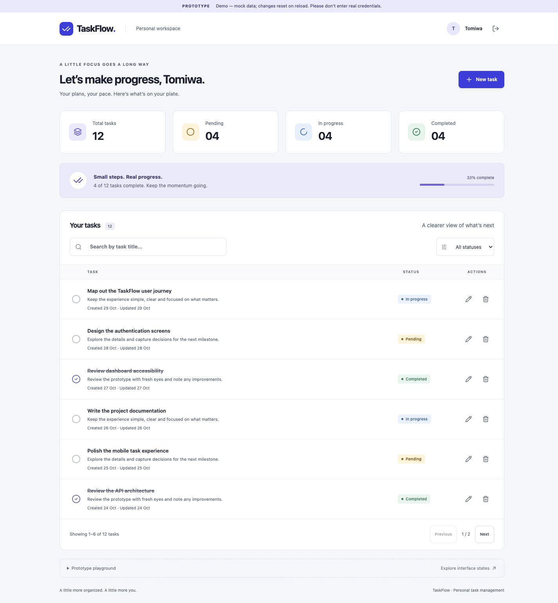

# TaskFlow — AppRo8 Task 2

A proposed full-stack task manager for the AppRo8 Full Stack Developer Internship (Weeks 3–4).

**Status: Phase 2 mock-data prototype built; desktop design approved; final responsive refinements verified. Production backend includes MongoDB lifecycle, the User model and Phase 3.3 cookie authentication; task endpoints and the production frontend remain unimplemented.**

Repository: [Oseni-Tomiwa/task-manager-fullstack](https://github.com/Oseni-Tomiwa/task-manager-fullstack).
Internal target: November 9, 2026. Official deadline: November 12, 2026.

## Planned features

Registration, login and logout; a protected dashboard; owner-scoped task creation, viewing, editing, completion and deletion; title search; status filters; summary counters; accessible responsive layouts; loading, empty, error and success states.

## Proposed stack and architecture

React, TypeScript, Vite, Tailwind CSS and React Router in `client/`; Node.js, Express, TypeScript, MongoDB Atlas, Mongoose, JWT, bcrypt and Zod in `server/`. One pnpm workspace, with ESLint, Prettier, Vitest and Supertest. No shared package until duplication justifies one.

Browser → React client → Express API → MongoDB Atlas. The API authenticates requests and enforces task ownership. Frontend deployment is planned for Vercel; backend deployment for Render.

## Planning documents

- [Phase 1: audit, scope, architecture, API and security](docs/phase-1-plan.md)
- [Prototype design, interactions and review checklist](docs/prototype-plan.md)
- [Cookie authentication recommendation](docs/authentication-decision.md)
- [Phase 2 verification](docs/phase-2-verification.md)
- [Final prototype review](docs/final-prototype-review.md)
- [Manual prototype Git handoff (historical)](docs/git-handoff/README.md)
- [Phase 3.1 backend foundation](docs/phase-3.1-backend.md)
- [Phase 3.2 MongoDB foundation](docs/phase-3.2-database.md)
- [Phase 3.3 secure authentication](docs/phase-3.3-authentication.md)

## Proposed repository structure

```text
task-manager-fullstack/
├── client/                  # Future production frontend
├── server/                  # Production backend foundation
├── prototype/               # Approved isolated mock-data prototype
├── docs/
├── .gitignore               # Environment and generated-file exclusions
├── pnpm-workspace.yaml      # Future tooling phase
├── pnpm-lock.yaml           # Future tooling phase
├── package.json             # Future tooling phase
├── README.md
└── LICENSE
```

The isolated `prototype/` and production backend foundation in `server/` exist. Each has its own pnpm manifest and lockfile. Root workspace setup is deferred until the production client is added, preserving prototype isolation.

## Installation, local development and testing

The prototype requires Node.js 22.13+ (verified on 24.22.1) and pnpm 10.15.1. From the repository root:

```bash
cd prototype
pnpm install --frozen-lockfile
pnpm dev
```

Open the URL printed by Vite (normally http://127.0.0.1:5173). Demo login: `demo@taskflow.app` / `TaskflowDemo!2026`. Registration simulates success with valid made-up details; no reusable account or password is stored. All changes and mock sessions reset on reload or logout.

```bash
pnpm typecheck
pnpm lint
pnpm format:check
pnpm build
```

Use **Prototype playground** on the dashboard to review loading, empty, load-error and mutation-failure states. See [Phase 2 verification](docs/phase-2-verification.md) for actual evidence and limitations. The prototype makes no API/database requests and requires no environment variables.

Current server variables: `PORT`, `HOST`, `NODE_ENV`, `MONGODB_URI`, `JWT_SECRET` and `CLIENT_ORIGIN`. Startup requires the database URI, a privately generated signing secret and the exact frontend origin. Planned client variable: `VITE_API_BASE_URL`, which is public and must never contain secrets. Future `.env.example` files will contain placeholders only; real environment files will be ignored.

Planned checks: lint, formatting, TypeScript checks, client/server builds, API integration tests and frontend interaction tests. Foundation HTTP and environment tests now exist in `server/`; see the Phase 3.1 report for executed results. Prototype static/build checks and browser walkthroughs are documented separately. See the acceptance matrix in the Phase 1 plan.

## API overview

Proposed `/api` routes cover health, registration, login, current user and owner-scoped task CRUD. List requests support title search and status filtering. See the planning document for contracts, limits and error behavior.

## Deployment and submission

Deployment has not been performed. No public live URLs are available. Local prototype screenshots are included below.

After implementation and explicit deployment approval: configure Vercel client routing, Render API environment and health checks, and Atlas access; verify the deployed end-to-end workflows. Then document verified URLs, screenshots, setup commands and test evidence. Confirm repository visibility and submit repository/frontend/backend URLs through the AppRo8 portal. No portal submission is performed by this planning phase.

## Prototype preview



[Mobile screenshot](docs/screenshots/dashboard-mobile.png) · [Tablet screenshot](docs/screenshots/dashboard-tablet.png)

## License

MIT — see [LICENSE](LICENSE).

## Production backend foundation

See [server/README.md](server/README.md) for setup, environment validation, scripts, health/errors and shutdown behavior. From the repository root:

```bash
cd server
pnpm install --frozen-lockfile
cp .env.example .env
# Configure MONGODB_URI, a private JWT_SECRET and exact CLIENT_ORIGIN.
# Start local MongoDB or use an authorized development database.
pnpm dev
```

`GET /api/health` returns HTTP 200 with `{"status":"ok"}`. Startup now requires an authorized local/development MongoDB URI and connects before listening; health remains process liveness. A typed User model defines validation and the unique email index. Cookie authentication is now implemented; no task API or deployment has been added.
